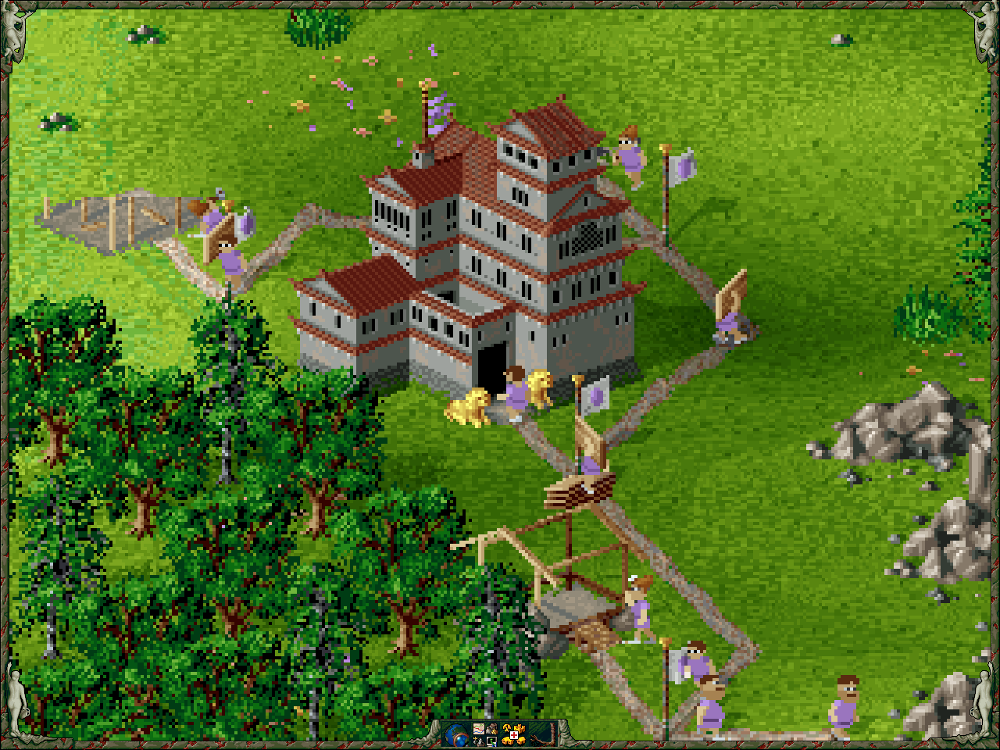
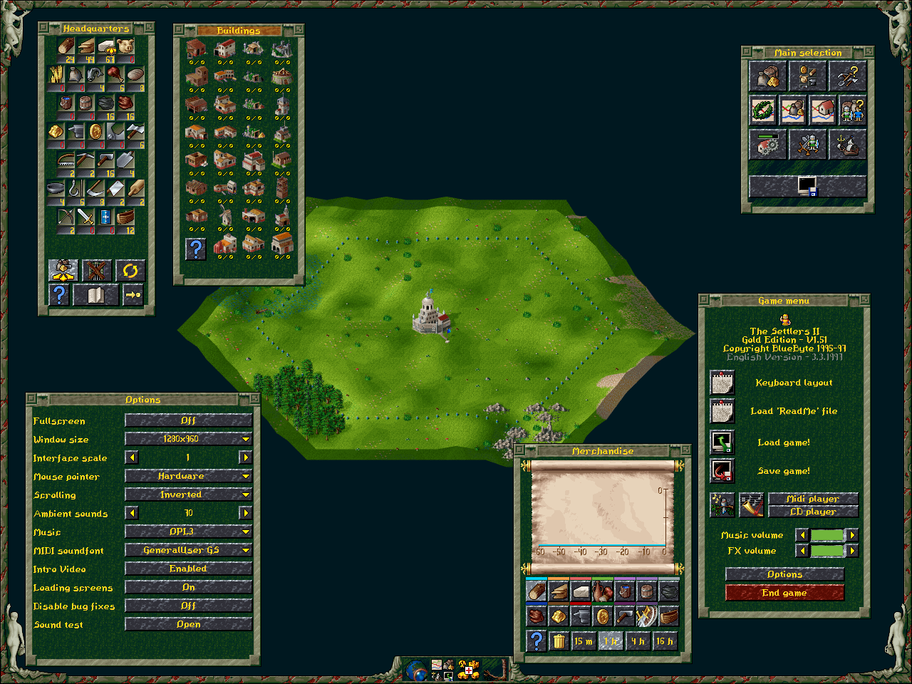
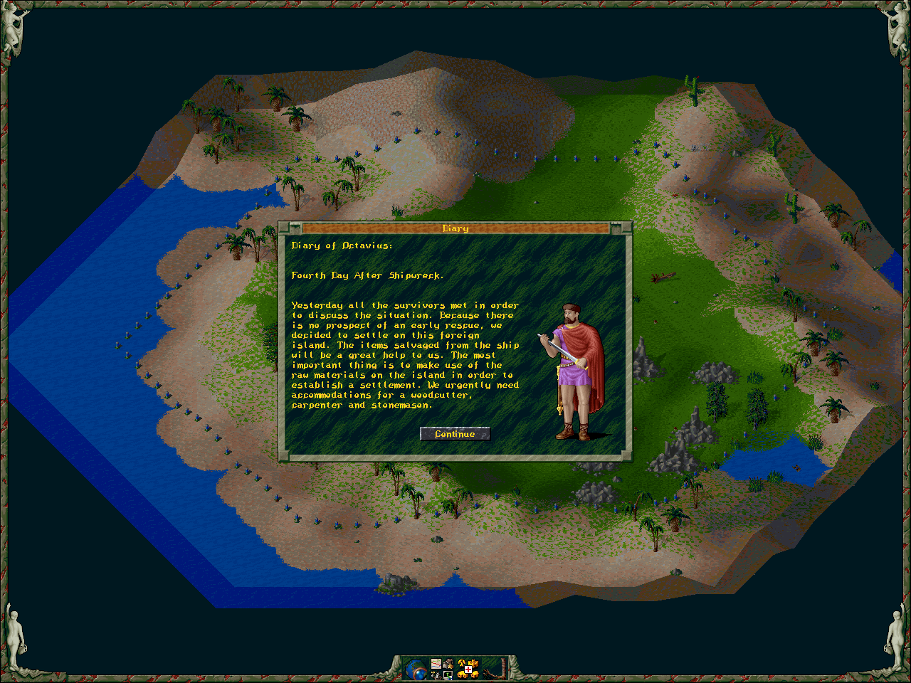
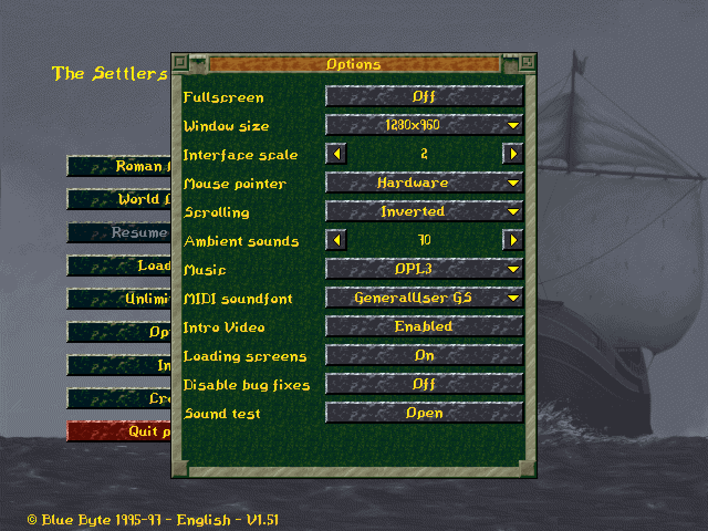

# Robigo

A modern engine for The Settlers II, written in Rust.

Robigo requires data from your own copy of the game.

The goal of this project was simple: to replicate as the game as closesly as possible for play
on modern computers while also adding useful improvements, i.e. bigger resolutions. 
Yes, there are ways to play the original and, yes there are other engines, but I really wanted to
do this myself, with a fresh slate using a language I already know.

Robigo (previously known as s2o3) is project I've been working on over the past several years,
I decided at last to release it to the public since it's now able to play skirmish and campaigns.

It was designed to draw the same pixels, plays the same sounds at the same times, and keeps its
simulation in step with the original's.

The version targetted was v1.51, the base game after its last official patch. 
Every behaviour it reproduces comes from that version, and in the code base it is simply referred
to as "S2".

Robigo was written from scratch. The original's behaviour was worked out by playing the game under DOSBox,
studying its data files, and then disassembling and decompiling S2 to study internal mechanics that are not 
easily observered otherwise. Everything was written up as notes, and the code was written from those notes. 
Sort of like a one-man-cleanroom. No code from S2, disassembled or otherwise, is in this 
repository in any form.

Fun fact: Robigo was (somewhat ironically) the Roman goddess of protecting wheat from rust.

## Status, is it finished?

No, the project is not finished, but the major things are working. 

### What is implemented so far

- The Roman campaign, the Gold Edition's World Campaign, and Unlimited Play on the game's maps.
- S2's original computer AI.
- Saving and loading.
- The FM music through an emulated OPL3, or the General MIDI music through a SoundFont, and the CD's
  music tracks from a CD image or a GOG installation.
- Mods that replace the game's files by path or change its data tables
  ([docs/design/mods.md](docs/design/mods.md)).

Robigo fixes a few outright bugs in S2 by default. "Disable bug fixes" in the options window puts
them back for the next new game, they're documented in [docs/design/bug-fixes.md](docs/design/bug-fixes.md).

I do not recommend disabling the bug fixes since they can lead to your current level becoming impossible to complete.

### What is planned

- Multiplayer.
- Custom AIs written in LUA.
- Better mod management.

### Bugs/Known issues

I'm still playtesting so I may find more.

- Cosmetic bug: When the force-out order is used on a ware in a storehouse (or HQ) but have no where to go, when the force-out order is cleared, the wares vanish and go back into the storehouse stock.
- Cosmetic bug: In some cases, when changing the UI scale the mouse cursor may flicker for a short time, still tracking down the cause.

## Screenshots

| | |
|---|---|
|  |  |
| The Japanese headquarters| The game's windows |
|  |  |
| The first Roman chapter, "Off we go" | Robigo's options over the main menu |

## What you need

- 64-bit Linux or Windows. macOS support has been accounted for but I haven't been able to test it.
- A graphics driver with Vulkan (Metal on macOS).
- A copy of Settlers 2, any one of:
  - the CD, or an image of it as an ISO or as BIN and CUE files
  - the Gold Edition's CD or an image of it
  - a GOG installation of the Gold Edition
- For a copy older than v1.51, such as the first CD's v1.03, the official v1.51 patch as well. The Gold
  Edition and the GOG installation are v1.51 already.

On the first start Robigo asks where your copy is, keeps a copy of its own and spends a minute or two
extracting what it needs from it. It never changes your files.

### macOS

If you have a Mac and can test for me, please let me know! Please report issues so I can add proper support.

## Getting it

Downloads for Linux (tar.gz, AppImage and deb) and Windows (zip and setup) are on the
[releases page](https://github.com/WelshProgrammer/RobigoEngine/releases). 

The READMEs describe how to install and where your saves and settings will go.

To build it yourself from source, [docs/building.md](docs/building.md) covers Linux, Windows and macOS.

## Contributing

Issues and pull requests are welcome. [CONTRIBUTING.md](CONTRIBUTING.md) has the rules, the layout of the
code and the checks to run first. The main rule: no file from the original game goes in the repository,
in any form.

## Licence

Robigo is free software under the GNU General Public License, version 3 or later. See [LICENSE](LICENSE).

Robigo is not affiliated with or endorsed by Ubisoft or Blue Byte. The Settlers is a trademark of Ubisoft
Entertainment. Again, you need your own copy of the game to play.

## Thanks

- [Return to the Roots](https://www.rttr.info), for inspiration and documentation.
- S. Christian Collins for GeneralUser GS, the default SoundFont.
- MuseScore General, the alternative SoundFont, after Frank Wen's FluidR3.
- Nuked-OPL3 by Nuke.YKT, which emulates the sound card's FM chip.
- SDL and wgpu, for the fundamentals.
